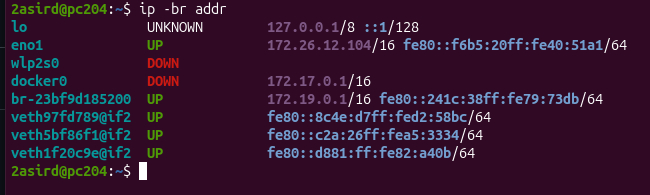
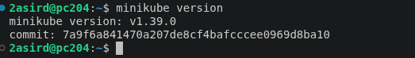
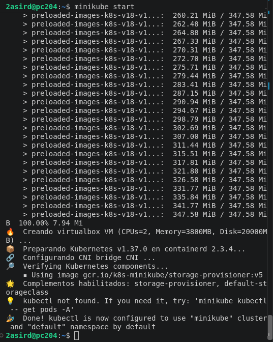
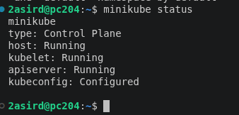
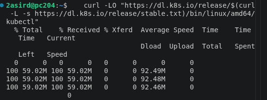
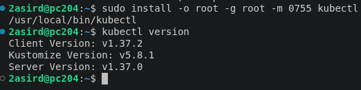
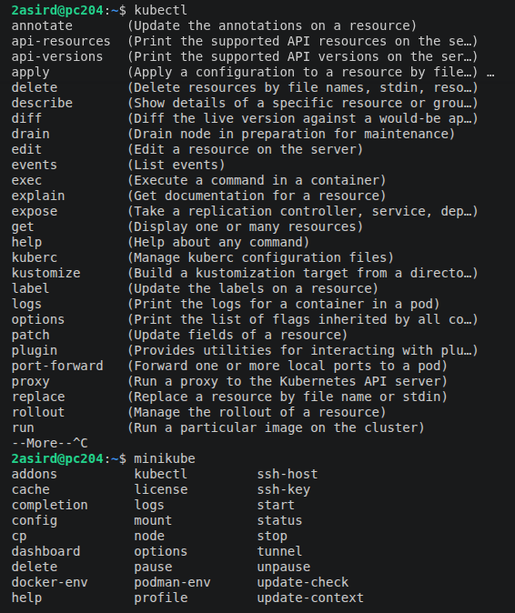
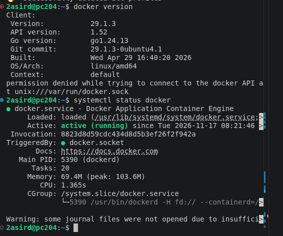
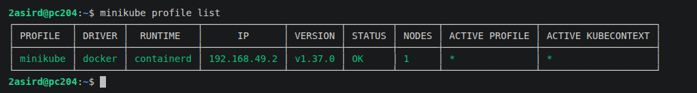

# 2. Instalación de Kubernetes (Minikube y kubectl)

En este documento se recogen y explican paso a paso las capturas correspondientes a la instalación de **Minikube** y **kubectl**, así como la configuración del clúster local primero con el driver de VirtualBox y posteriormente con el driver de Docker.

---

## Paso 1: Comprobación de interfaces de red

Se comprueban las interfaces de red del equipo anfitrión con `ip -br addr` antes de iniciar la instalación (se observan `eno1`, `docker0`, `br-23bf9d185200`, etc.).

---

## Paso 2: Descarga del binario de Minikube

Se descarga la última versión del binario de Minikube para Linux (`minikube-linux-amd64`) mediante `curl -LO https://github.com/kubernetes/minikube/releases/latest/download/minikube-linux-amd64`.

---

## Paso 3: Instalación de Minikube en `/usr/local/bin`

Se instala el binario descargado en `/usr/local/bin/minikube` y se elimina el archivo temporal con `sudo install minikube-linux-amd64 /usr/local/bin/minikube && rm minikube-linux-amd64`.

---

## Paso 4: Verificación de la versión de Minikube

Se comprueba que Minikube está instalado correctamente ejecutando `minikube version`, mostrando `minikube version: v1.39.0`.

---

## Paso 5: Primer arranque del clúster (`minikube start`)

Se inicia el clúster local con `minikube start`. Minikube descarga las imágenes precargadas, crea una máquina virtual de VirtualBox (2 CPUs, 3800 MB de RAM, 20000 MB de disco), prepara Kubernetes `v1.37.0` sobre `containerd 2.3.4`, configura la red CNI y habilita `storage-provisioner` y `default-storageclass`.

---

## Paso 6: Comprobación del estado de Minikube

Con `minikube status` se verifica que el plano de control (`host`, `kubelet`, `apiserver`) está en estado `Running` y `kubeconfig` aparece como `Configured`.

---

## Paso 7: Listado de perfiles de Minikube (VirtualBox)

Ejecutando `minikube profile list` se comprueba el perfil activo `minikube`, utilizando el driver `virtualbox`, runtime `containerd`, IP `192.168.59.100`, versión `v1.37.0` y estado `OK`.

---

## Paso 8: Descarga de `kubectl`

Como `kubectl` no estaba instalado en el sistema, se descarga la última versión estable mediante `curl -LO "https://dl.k8s.io/release/$(curl -L -s https://dl.k8s.io/release/stable.txt)/bin/linux/amd64/kubectl"`.

---

## Paso 9: Instalación y verificación de `kubectl`

Se instala el binario en `/usr/local/bin/kubectl` con `sudo install -o root -g root -m 0755 kubectl /usr/local/bin/kubectl` y se comprueba con `kubectl version` (`Client Version: v1.37.2`, `Kustomize Version: v5.8.1`, `Server Version: v1.37.0`).

---

## Paso 10: Verificación del nodo con `kubectl get nodes`

Con `kubectl get nodes -o wide` se confirma que el nodo `minikube` está en estado `Ready` con rol `control-plane`, versión `v1.37.0`, IP `192.168.59.100` y runtime `containerd://2.3.4`.

---

## Paso 11: Ayuda de comandos de `kubectl` y `minikube`

Se consultan los subcomandos disponibles ejecutando `kubectl` y `minikube` sin argumentos.

---

## Paso 12: Eliminación del perfil anterior de Minikube

Para cambiar el driver de VirtualBox a Docker, se elimina el clúster anterior con `minikube delete --all`.

---

## Paso 13: Comprobación de Docker y su servicio

Se verifica Docker con `docker version` (donde inicialmente aparece un error de permisos sobre `/var/run/docker.sock`) y `systemctl status docker`, confirmando que `docker.service` está `active (running)`.

---

## Paso 14: Prueba de funcionamiento de Docker (`hello-world`)

Se ejecuta `sudo docker run hello-world` para comprobar que el demonio de Docker descarga imágenes y ejecuta contenedores correctamente.

---

## Paso 15: Instalación de dependencia y aplicación de grupo `docker`

Se instala el paquete `util-linux-extra` mediante `sudo apt install util-linux-extra` y se ejecuta `newgrp docker` para aplicar los permisos del grupo `docker` en la sesión actual sin necesidad de `sudo`.

---

## Paso 16: Perfil de Minikube usando el driver `docker`

Tras iniciar Minikube con el driver de Docker, `minikube profile list` muestra el perfil `minikube` con `DRIVER: docker`, `RUNTIME: containerd`, IP `192.168.49.2`, versión `v1.37.0` y estado `OK`.

---

## Paso 17: Verificación final del nodo con driver Docker

Finalmente, `kubectl get nodes -o wide` confirma que el nodo `minikube` está `Ready` como `control-plane` con IP `192.168.49.2`, sistema operativo `Debian GNU/Linux 12 (bookworm)` y runtime `containerd://2.3.4`.

---

[⬅️ Volver al índice](../README.md)
