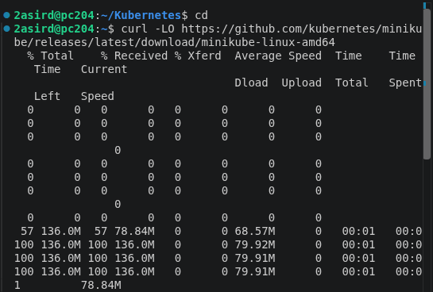
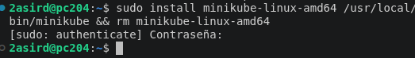
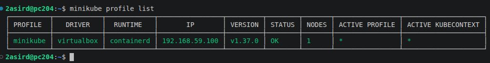
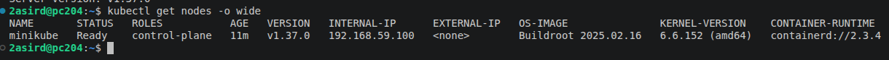
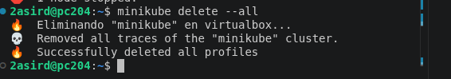
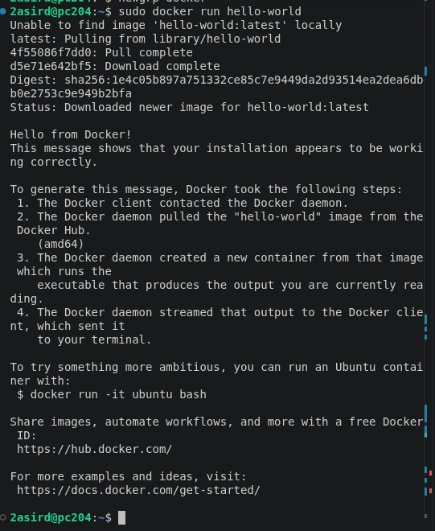
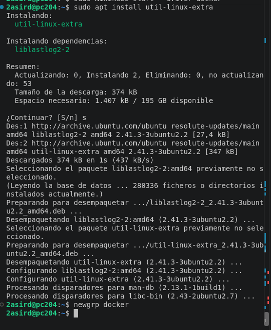
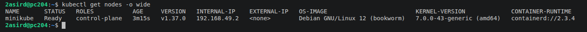

[⬅️ Anterior: 1. Introducción](../Introduccion/) · [🏠 Volver al índice](../README.md) · [➡️ Siguiente: 3. PODS](../PODS/)

---

# ⚙️ 2. Instalación de Kubernetes (`Minikube` y `kubectl`)

Guía visual paso a paso de la instalación y verificación de un clúster local de Kubernetes utilizando **Minikube** y la herramienta de línea de comandos **`kubectl`**.

| Componente | Versión instalada | Detalles |
| :--- | :---: | :--- |
| **Minikube** | `v1.39.0` | Clúster local de un nodo (`control-plane`) |
| **Kubernetes (Server)** | `v1.37.0` | Ejecutado sobre `containerd://2.3.4` |
| **kubectl (Client)** | `v1.37.2` | Incluye `Kustomize v5.8.1` |
| **Drivers probados** | `virtualbox` / `docker` | Configuración definitiva sobre **Docker** (`192.168.49.2`) |

---

## 🔹 Fase 1: Preparación e instalación de Minikube

### Paso 1 · Comprobación inicial de interfaces de red
```bash
ip -br addr
```


Se revisan las interfaces de red activas en el equipo anfitrión (`eno1`, `docker0`, puentes virtuales, etc.) antes de comenzar la instalación.

---

### Paso 2 · Descarga del binario oficial de Minikube
```bash
curl -LO https://github.com/kubernetes/minikube/releases/latest/download/minikube-linux-amd64
```


Se descarga el ejecutable más reciente de Minikube para arquitectura Linux `amd64`.

---

### Paso 3 · Instalación en `/usr/local/bin`
```bash
sudo install minikube-linux-amd64 /usr/local/bin/minikube && rm minikube-linux-amd64
```


Se copia el binario con permisos de ejecución a `/usr/local/bin/minikube` y se elimina el instalador descargado.

---

### Paso 4 · Comprobación de la versión instalada
```bash
minikube version
```


Se confirma la instalación correcta de `minikube version: v1.39.0`.

---

## 🔹 Fase 2: Primer arranque con VirtualBox e instalación de `kubectl`

### Paso 5 · Arranque inicial del clúster (`minikube start`)
```bash
minikube start
```


Minikube descarga la imagen base, crea una máquina virtual en **VirtualBox** (2 CPUs, 3800 MB RAM, 20 GB de disco), levanta Kubernetes `v1.37.0` con `containerd 2.3.4` y activa los complementos `storage-provisioner` y `default-storageclass`.

---

### Paso 6 · Estado de los servicios del Control Plane
```bash
minikube status
```


Se comprueba que `host`, `kubelet` y `apiserver` están en estado `Running`, y `kubeconfig` aparece `Configured`.

---

### Paso 7 · Verificación del perfil activo (VirtualBox)
```bash
minikube profile list
```


Muestra el perfil `minikube` ejecutándose con el driver `virtualbox` en la IP `192.168.59.100`.

---

### Paso 8 · Descarga del cliente `kubectl`
```bash
curl -LO "https://dl.k8s.io/release/$(curl -L -s https://dl.k8s.io/release/stable.txt)/bin/linux/amd64/kubectl"
```


Al no disponer aún del cliente `kubectl` en el sistema, se descarga la versión estable oficial.

---

### Paso 9 · Instalación y comprobación de versiones
```bash
sudo install -o root -g root -m 0755 kubectl /usr/local/bin/kubectl
kubectl version
```


Se instala `kubectl` en `/usr/local/bin` y se comprueba la conectividad tanto del cliente (`v1.37.2`) como del servidor Kubernetes (`v1.37.0`).

---

### Paso 10 · Consulta del nodo del clúster
```bash
kubectl get nodes -o wide
```


El nodo `minikube` aparece en estado `Ready` con el rol `control-plane`.

---

### Paso 11 · Exploración de comandos disponibles
```bash
kubectl
minikube
```


Revisión de la ayuda integrada con los principales subcomandos de administración de `kubectl` y `minikube`.

---

## 🔹 Fase 3: Migración del clúster al driver de Docker

### Paso 12 · Eliminación del perfil en VirtualBox
```bash
minikube delete --all
```


Se borra por completo el clúster anterior para volver a desplegarlo de forma más ligera usando **Docker** como driver.

---

### Paso 13 · Revisión del servicio Docker
```bash
docker version
systemctl status docker
```


Se comprueba que `docker.service` está activo (`active (running)`), detectando que el usuario actual aún necesita permisos de acceso al socket `/var/run/docker.sock`.

---

### Paso 14 · Prueba funcional de Docker
```bash
sudo docker run hello-world
```


Se valida que el motor de Docker descarga imágenes de Docker Hub y ejecuta contenedores sin errores.

---

### Paso 15 · Dependencias y activación del grupo `docker`
```bash
sudo apt install util-linux-extra
newgrp docker
```


> [!TIP]
> Ejecutar `newgrp docker` recarga la pertenencia al grupo `docker` en la terminal actual sin necesidad de cerrar sesión, permitiendo a Minikube usar Docker sin `sudo`.

---

### Paso 16 · Verificación del nuevo perfil sobre Docker
```bash
minikube profile list
```


El perfil `minikube` queda operativo con `DRIVER: docker`, `RUNTIME: containerd` e IP interna `192.168.49.2`.

---

### Paso 17 · Comprobación final del clúster
```bash
kubectl get nodes -o wide
```


El nodo `minikube` (`Debian GNU/Linux 12 (bookworm)`, `containerd://2.3.4`) responde en estado `Ready`, dejando el entorno listo para trabajar con Pods.

---

[⬅️ Anterior: 1. Introducción](../Introduccion/) · [🏠 Volver al índice](../README.md) · [➡️ Siguiente: 3. PODS](../PODS/)
