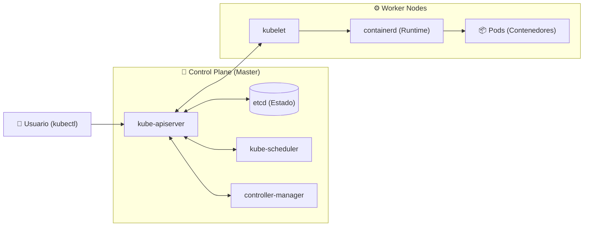

[🏠 Volver al índice](../README.md) · [➡️ Siguiente: 2. Instalación](../Instalacion/)

---

# 📘 1. Introducción a Kubernetes

Este apartado resume los conceptos fundamentales del **Módulo 1** y establece la base teórica para las prácticas del repositorio.

---

## 🌍 1. El problema real en producción

Hoy en día las aplicaciones modernas se enfrentan a cuatro exigencias críticas:

- 🕒 **Disponibilidad 24/7:** el servicio debe estar activo en todo momento.
- 👥 **Alta concurrencia:** miles de usuarios accediendo de forma simultánea.
- 🔄 **Cambios constantes:** despliegues frecuentes de nuevas versiones.
- 🛡️ **Cero paradas (*Zero Downtime*):** actualizar o recuperarse de caídas sin interrumpir al usuario.

---

## 📦 2. Contenedores: la primera solución

Un **contenedor** empaqueta una aplicación junto con todas sus dependencias para aislarla y garantizar que funcione exactamente igual en cualquier máquina (*fin del clásico «en mi máquina funcionaba»*).

> [!WARNING]
> **¿Por qué los contenedores sueltos no bastan en producción?**
> Por sí solos **no escalan automáticamente** ante picos de tráfico, **no se recuperan solos** si un proceso o servidor cae y **no reparten la carga** entre varias copias.

---

## ☸️ 3. ¿Qué es Kubernetes?

**Kubernetes (K8s)** es un **orquestador de contenedores** de grado de producción que automatiza la operación de decenas o cientos de contenedores repartidos en varios servidores:

| Capacidad | Qué hace Kubernetes automáticamente |
| :--- | :--- |
| **Planificación** | Decide en qué servidor (*nodo*) ejecutar cada contenedor según los recursos disponibles. |
| **Auto-recuperación** | Detecta fallos y vuelve a levantar los contenedores caídos para mantener las copias deseadas. |
| **Escalado** | Aumenta o reduce el número de réplicas según la carga. |
| **Despliegue continuo** | Actualiza versiones progresivamente sin detener el servicio. |

---

## 🏗️ 4. Arquitectura de un clúster de Kubernetes

Un **clúster** es un conjunto de máquinas (**nodos**) que trabajan en equipo y se dividen en dos planos:

### 🧠 Control Plane (Master)
Es la parte que **decide y controla** el clúster (no ejecuta las aplicaciones del usuario):
- **API Server (`kube-apiserver`):** punto de entrada único al clúster; todas las órdenes pasan por aquí.
- **etcd:** base de datos clave-valor donde se guarda todo el estado del clúster.
- **Scheduler (`kube-scheduler`):** decide en qué *Worker Node* se ejecutará cada nuevo Pod.
- **Controller Manager:** vigila continuamente que el estado real coincida con el estado declarado (por ejemplo, mantener siempre 3 réplicas).

### ⚙️ Worker Nodes
Son las máquinas donde **se ejecutan realmente las aplicaciones** dentro de **Pods** (grupos de uno o varios contenedores que comparten red y almacenamiento):
- **kubelet:** agente instalado en cada nodo que recibe las órdenes del *Control Plane* y se asegura de que los contenedores estén funcionando.
- **Runtime de contenedores (`containerd`):** motor encargado de arrancar y parar los contenedores.

---

## ⚖️ 5. Comparativa con otros orquestadores

Además de alternativas como **Apache Mesos** o **HashiCorp Nomad**, la comparativa más habitual es frente a **Docker Swarm**:

| Característica | 🐳 Docker Swarm | ☸️ Kubernetes |
| :--- | :--- | :--- |
| **Tipo** | Orquestador básico integrado en Docker | Orquestador completo independiente |
| **Curva de aprendizaje** | Muy sencilla | Más compleja |
| **Escalado y alta disponibilidad** | Básico / Limitada | Avanzado / Completa |
| **Actualizaciones sin parada** | Básicas | Muy avanzadas |
| **Adopción actual** | Pequeños entornos / en desuso | **Estándar de facto en producción** |

---

## 🧭 Recorrido práctico de este repositorio

1. **[⚙️ 2. Instalación](../Instalacion/):** puesta en marcha del entorno local con **Minikube** y **kubectl** sobre VirtualBox y Docker.
2. **[📦 3. PODS](../PODS/):** ciclo de vida de Pods individuales y comunicación mediante volúmenes en Pods multicontenedor.
3. **[🔁 4. Replica sets](../replica%20sets/):** garantía de disponibilidad manteniendo múltiples réplicas activas.
4. **[🚀 5. Deployments](../deployments/):** automatización de despliegues y actualizaciones continuas.

---

[🏠 Volver al índice](../README.md) · [➡️ Siguiente: 2. Instalación](../Instalacion/)
