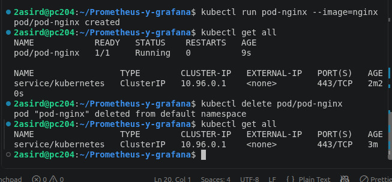
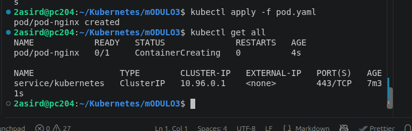
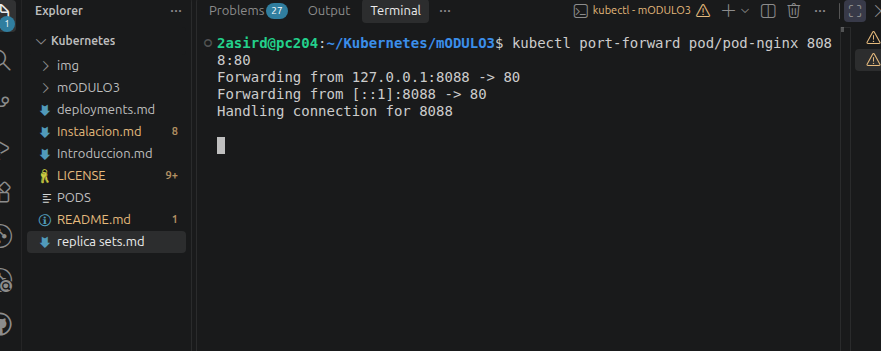
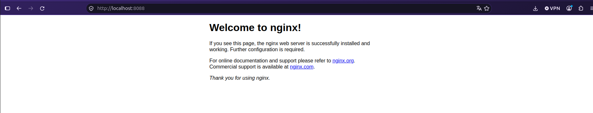
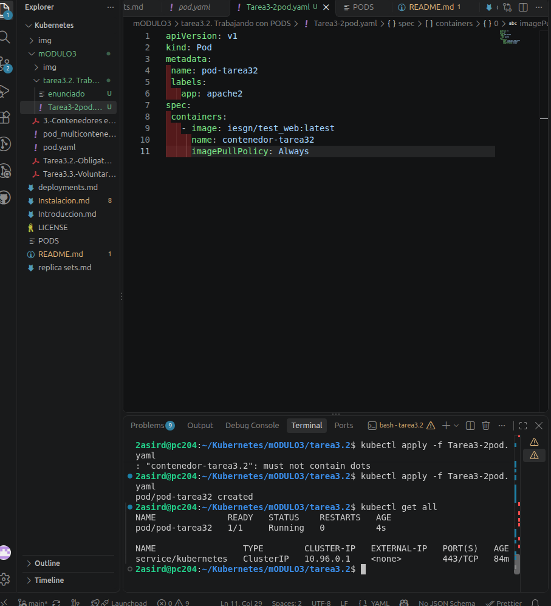
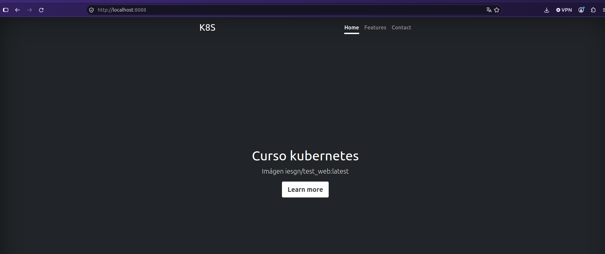

# Tarea 3.2 - Trabajando con Pods

En este documento se recogen y explican las capturas correspondientes a la práctica de creación, inspección, acceso y exposición de Pods en Kubernetes.

---

## Captura 3.1: Creación y eliminación imperativa de un Pod

Se crea un Pod llamado `pod-nginx` de forma imperativa con `kubectl run pod-nginx --image=nginx`. A continuación, con `kubectl get all` se comprueba que el Pod está en estado `Running` (`1/1`), se elimina mediante `kubectl delete pod/pod-nginx` y se vuelve a ejecutar `kubectl get all` para verificar que ha sido borrado del namespace `default`.

---

## Captura 3.2: Creación declarativa de un Pod desde YAML

Se aplica el manifiesto `pod.yaml` mediante `kubectl apply -f pod.yaml` para crear `pod/pod-nginx`. Al ejecutar `kubectl get all` inmediatamente después, el Pod aparece en estado `ContainerCreating` (`0/1` listo) mientras se descarga la imagen y se inicia el contenedor.

---

## Captura 3.3: Información detallada del Pod (`kubectl describe`)

Mediante `kubectl describe pod/pod-nginx` se obtiene información detallada del Pod: nodo asignado (`minikube/192.168.49.2`), etiquetas (`app=nginx`, `service=web`), estado `Running`, IP asignada (`10.244.0.4`), detalles del contenedor `contenedor-nginx` (imagen `nginx:1.16`), condiciones (`Ready: True`), volúmenes montados y los primeros eventos de programación y descarga de la imagen (`Scheduled`, `Pulling`, `Pulled`).

---

## Captura 3.4: Eventos finales y comprobación del estado `Running`

Continuación de la salida de `kubectl describe pod/pod-nginx` donde se muestran los eventos `Created` y `Started` del contenedor `contenedor-nginx`. Seguidamente, `kubectl get all` confirma que `pod/pod-nginx` ya se encuentra `1/1` en estado `Running`.

---

## Captura 3.5: Acceso interactivo al contenedor

Se accede de forma interactiva a una shell dentro del contenedor mediante `kubectl exec pod/pod-nginx -it -- /bin/bash`. Dentro del contenedor se ejecutan `cat /etc/os-release` (que muestra Debian GNU/Linux 10 buster), `uname -a`, `ls` y `getent passwd` (donde figura el usuario `nginx`).

---

## Captura 3.6: Redirección de puertos (`port-forward`)

Se crea un túnel hacia el puerto `80` del Pod `pod-nginx` desde el puerto local `8088` usando `kubectl port-forward pod/pod-nginx 8088:80`, quedando a la escucha en `127.0.0.1:8088` y `[::1]:8088`.

---

## Captura 3.7: Acceso desde el navegador a Nginx

Al abrir `http://localhost:8088` en el navegador web, se muestra la página de bienvenida por defecto del servidor Nginx (*"Welcome to nginx!"*), confirmando que el reenvío de puertos funciona correctamente.

---

## Captura 3.8: Consulta de logs del Pod

Con `kubectl logs pod/pod-nginx` se muestran los registros de acceso y error de Nginx, reflejando la petición `GET / HTTP/1.1` con código `200` y la petición `GET /favicon.ico HTTP/1.1` con código `404` realizadas desde el navegador.

---

## Captura 3.9: Despliegue de `Tarea3-2pod.yaml`

Se muestra la definición corregida de `Tarea3-2pod.yaml` (Pod `pod-tarea32`, etiqueta `app: apache2`, contenedor `contenedor-tarea32` con la imagen `iesgn/test_web:latest` y `imagePullPolicy: Always`). En la terminal se observa el error previo cuando el nombre del contenedor contenía un punto (`must not contain dots`), seguido de la creación correcta con `kubectl apply -f Tarea3-2pod.yaml` y la verificación con `kubectl get all` (`pod/pod-tarea32` en `1/1 Running`).

---

## Captura 3.10: Redirección de puertos hacia `pod-tarea32`

Se ejecuta `kubectl port-forward pod/pod-tarea32 8088:80` para redirigir el puerto local `8088` al puerto `80` del Pod `pod-tarea32`.

---

## Captura 3.11: Visualización de la web de `iesgn/test_web:latest`

Al acceder a `http://localhost:8088` en el navegador, se visualiza la página web servida por Apache desde la imagen `iesgn/test_web:latest` (*"Curso kubernetes - Imágen iesgn/test_web:latest"*).

---

## Captura 3.12: Modificación de `index.html` dentro del Pod

Se accede al interior del contenedor mediante `kubectl exec pod/pod-tarea32 -it -- /bin/bash`, se sobrescribe el fichero `/usr/local/apache2/htdocs/index.html` con `echo "Soy Daniel Romero">index.html`, se sale de la sesión (`exit`) y se vuelve a iniciar `kubectl port-forward pod/pod-tarea32 8088:80`.

---

## Captura 3.13: Comprobación del `index.html` modificado en el navegador

Al recargar `http://localhost:8088` en el navegador web, se muestra el nuevo contenido del fichero `index.html` (*"Soy Daniel Romero"*).

---

[⬅️ Volver a PODS](../../README.md) · [🏠 Volver al índice](../../../README.md)
