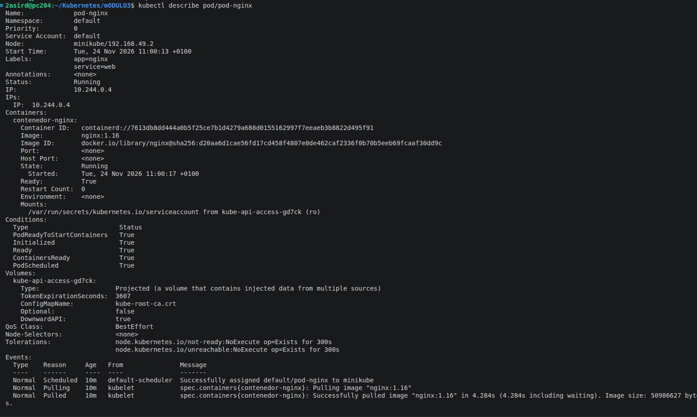
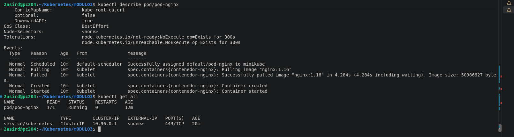
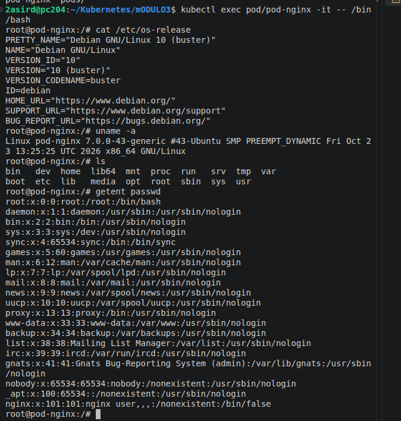
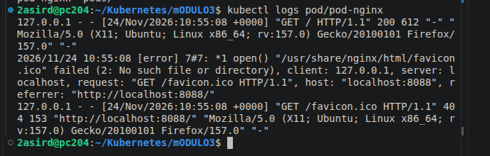
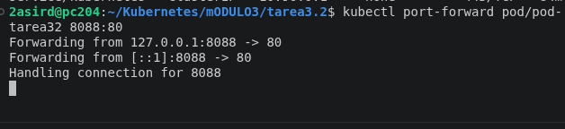
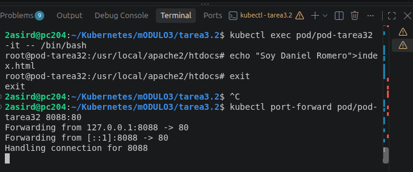
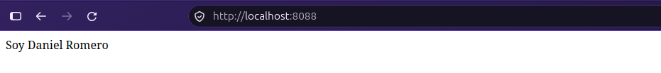

[⬅️ Volver a PODS](../../README.md) · [🏠 Volver al índice](../../../README.md) · [➡️ Siguiente: Tarea 3.3](../tarea3.3.-Trabajando%20con%20un%20POD%20multicontenedor/)

---

# 📝 Tarea 3.2 · Trabajando con Pods

Práctica completa sobre creación, inspección, acceso interactivo, exposición local y consulta de logs de Pods en Kubernetes.

- 📄 **Enunciado:** [`enunciado`](./enunciado)
- ⚙️ **Manifiesto YAML de la tarea:** [`Tarea3-2pod.yaml`](./Tarea3-2pod.yaml)

---

## 🧪 Parte A: Pruebas iniciales con `pod-nginx`

### Captura 3.1 · Creación y eliminación imperativa de un Pod
```bash
kubectl run pod-nginx --image=nginx
kubectl get all
kubectl delete pod/pod-nginx
```


Se lanza `pod-nginx` directamente desde línea de comandos, se comprueba que pasa a `1/1 Running`, se elimina con `kubectl delete` y se verifica que desaparece del namespace `default`.

---

### Captura 3.2 · Creación declarativa desde manifiesto YAML
```bash
kubectl apply -f pod.yaml
kubectl get all
```


Se despliega `pod/pod-nginx` a partir del fichero `pod.yaml`. En los primeros segundos aparece en estado `ContainerCreating` (`0/1`) mientras se descarga e inicia la imagen.

---

### Captura 3.3 · Inspección detallada del Pod (`kubectl describe`)
```bash
kubectl describe pod/pod-nginx
```


Muestra toda la ficha técnica del Pod: nodo (`minikube/192.168.49.2`), etiquetas (`app=nginx`, `service=web`), IP interna (`10.244.0.4`), contenedor `contenedor-nginx` con imagen `nginx:1.16`, condiciones de salud y los primeros eventos (`Scheduled`, `Pulling`, `Pulled`).

---

### Captura 3.4 · Eventos de arranque y estado `Running`


Final de la salida de `kubectl describe` con los eventos `Created` y `Started`. Al ejecutar `kubectl get all`, se confirma que `pod/pod-nginx` está `1/1 Running`.

---

### Captura 3.5 · Acceso interactivo por consola (`kubectl exec`)
```bash
kubectl exec pod/pod-nginx -it -- /bin/bash
```


Se abre una sesión Bash interactiva dentro del contenedor para inspeccionar el sistema base (`cat /etc/os-release` → *Debian GNU/Linux 10 buster*, `uname -a`, `ls` y `getent passwd`).

---

### Captura 3.6 · Redirección de puertos (`port-forward`)
```bash
kubectl port-forward pod/pod-nginx 8088:80
```


Se redirige el puerto `8088` de `localhost` (`127.0.0.1` y `::1`) hacia el puerto `80` del Pod.

---

### Captura 3.7 · Comprobación en el navegador web


Al visitar `http://localhost:8088`, Nginx responde con su página de bienvenida por defecto (*"Welcome to nginx!"*).

---

### Captura 3.8 · Consulta de registros (`kubectl logs`)
```bash
kubectl logs pod/pod-nginx
```


Se visualizan las trazas HTTP registradas por Nginx tras el acceso desde Firefox (`GET /` con código `200` y `GET /favicon.ico` con código `404`).

---

## 🎯 Parte B: Despliegue del Pod de la Tarea 3.2 (`pod-tarea32`)

Manifiesto utilizado en [`Tarea3-2pod.yaml`](./Tarea3-2pod.yaml):

```yaml
apiVersion: v1
kind: Pod
metadata:
  name: pod-tarea32
  labels:
    app: apache2
spec:
  containers:
    - image: iesgn/test_web:latest
      name: contenedor-tarea32
      imagePullPolicy: Always
```

> [!IMPORTANT]
> En Kubernetes el campo `spec.containers[].name` sigue la norma RFC 1123 (*DNS Label*): solo admite minúsculas, números y guiones `-` (**no permite puntos `.`**).

---

### Captura 3.9 · Aplicación del manifiesto y puesta en marcha
```bash
kubectl apply -f Tarea3-2pod.yaml
kubectl get all
```


Tras sustituir el punto del nombre del contenedor (`contenedor-tarea32`), el Pod `pod-tarea32` se crea sin errores y pasa a estado `1/1 Running`.

---

### Captura 3.10 · Exposición local con `port-forward`
```bash
kubectl port-forward pod/pod-tarea32 8088:80
```


Se enlaza el puerto local `8088` con el puerto `80` donde escucha Apache dentro de `pod-tarea32`.

---

### Captura 3.11 · Acceso inicial a la aplicación web


En `http://localhost:8088` se carga la página estática incluida en la imagen `iesgn/test_web:latest` (*"Curso kubernetes"*).

---

### Captura 3.12 · Personalización del `index.html` en el `DocumentRoot`
```bash
kubectl exec pod/pod-tarea32 -it -- /bin/bash
echo "Soy Daniel Romero" > index.html
exit
kubectl port-forward pod/pod-tarea32 8088:80
```


Se entra al contenedor en `/usr/local/apache2/htdocs`, se reemplaza el contenido de `index.html` con un mensaje personalizado y se reactiva el reenvío de puertos.

---

### Captura 3.13 · Verificación del cambio en el navegador


Al refrescar `http://localhost:8088`, Apache sirve el nuevo contenido modificado (*"Soy Daniel Romero"*).

---

[⬅️ Volver a PODS](../../README.md) · [🏠 Volver al índice](../../../README.md) · [➡️ Siguiente: Tarea 3.3](../tarea3.3.-Trabajando%20con%20un%20POD%20multicontenedor/)
