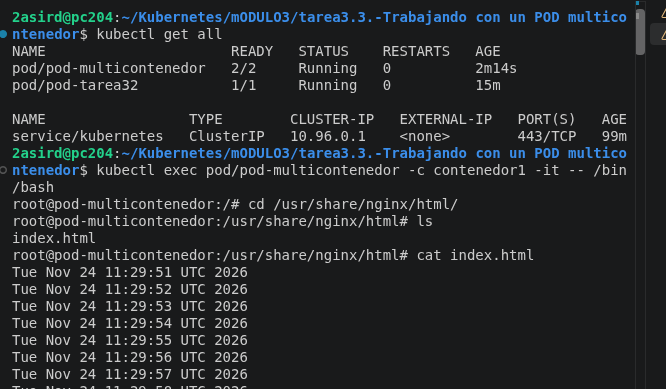
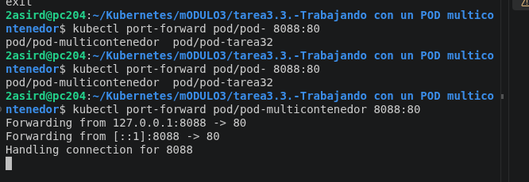
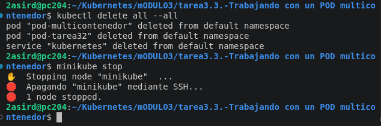

# Tarea 3.3 - Trabajando con un Pod multicontenedor

En este documento se recogen y explican las capturas correspondientes a la práctica con un Pod multicontenedor (`pod-multicontenedor`) que comparte almacenamiento mediante un volumen `emptyDir`.

---

## Captura 4.1: Comprobación del estado del Pod multicontenedor


Al ejecutar `kubectl get all`, se verifica que `pod/pod-multicontenedor` está en estado `Running` con `2/2` contenedores listos (`contenedor1` con `nginx` y `contenedor2` con `debian`), junto con `pod/pod-tarea32` (`1/1 Running`).

---

## Captura 4.2: Verificación del volumen compartido desde `contenedor1`



Se accede de forma interactiva al primer contenedor (`contenedor1`) especificándolo con la opción `-c`:

```bash
kubectl exec pod/pod-multicontenedor -c contenedor1 -it -- /bin/bash
```

Dentro de `/usr/share/nginx/html/`, al listar y mostrar el contenido de `index.html`, se comprueba que contiene las marcas de fecha y hora que `contenedor2` va añadiendo cada segundo en `/html/index.html` gracias al volumen compartido `html` (`emptyDir`).

---

## Captura 4.3: Redirección de puertos hacia el Pod multicontenedor



Se ejecuta `kubectl port-forward pod/pod-multicontenedor 8088:80` para exponer en `localhost:8088` el servidor Nginx que escucha en el puerto `80` dentro del Pod.

---

## Captura 4.4: Visualización en el navegador del `index.html` dinámico


Al acceder a `http://localhost:8088` desde el navegador web, se visualizan las líneas con la fecha y hora generadas continuamente por `contenedor2` y servidas por `contenedor1`.

---

## Captura 4.5: Limpieza de recursos y parada de Minikube



Se eliminan todos los recursos del namespace `default` con `kubectl delete all --all` (borrando `pod-multicontenedor`, `pod-tarea32` y `service/kubernetes`) y se detiene el nodo de Minikube mediante `minikube stop`.

---

[⬅️ Volver a PODS](../../README.md) · [🏠 Volver al índice](../../../README.md)
