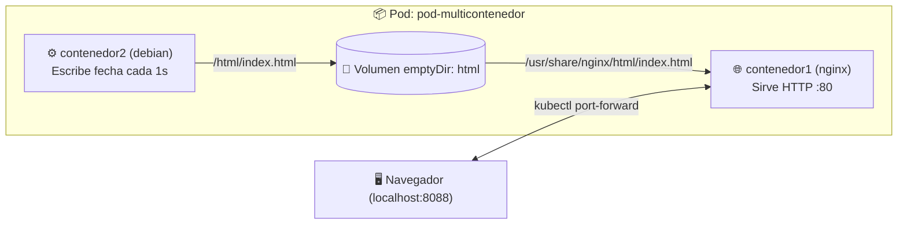
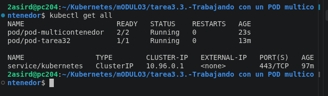

[⬅️ Anterior: Tarea 3.2](../tarea3.2.%20Trabajando%20con%20PODS/) · [⬅️ Volver a PODS](../../README.md) · [🏠 Volver al índice](../../../README.md)

---

# 🔗 Tarea 3.3 · Trabajando con un Pod Multicontenedor

Práctica sobre cooperación entre dos contenedores dentro de un mismo Pod (`pod-multicontenedor`) compartiendo archivos en tiempo real a través de un volumen efímero `emptyDir`.

- ⚙️ **Manifiesto YAML:** [`pod_multicontenedor.yaml`](./pod_multicontenedor.yaml)

---

## 🧩 Arquitectura del Pod Multicontenedor



<details>
<summary>📄 <strong>Ver definición completa de <code>pod_multicontenedor.yaml</code></strong></summary>

```yaml
apiVersion: v1
kind: Pod
metadata:
  name: pod-multicontenedor
spec:
  volumes:
  - name: html
    emptyDir: {}
  containers:
  - name: contenedor1
    image: nginx
    volumeMounts:
    - name: html
      mountPath: /usr/share/nginx/html
  - name: contenedor2
    image: debian
    volumeMounts:
    - name: html
      mountPath: /html
    command: ["/bin/sh", "-c"]
    args:
      - while true; do
          date >> /html/index.html;
          sleep 1;
        done
```

</details>

> [!NOTE]
> Los volúmenes `emptyDir` son **efímeros**: se crean al asignarse el Pod a un nodo y su contenido desaparece automáticamente cuando el Pod se elimina.

---

## 📸 Desarrollo paso a paso

### Captura 4.1 · Comprobación de los dos contenedores activos
```bash
kubectl get all
```


Se verifica que `pod/pod-multicontenedor` aparece en estado `Running` con **`2/2` contenedores listos** (`contenedor1` y `contenedor2`).

---

### Captura 4.2 · Inspección del volumen compartido desde `contenedor1`
```bash
kubectl exec pod/pod-multicontenedor -c contenedor1 -it -- /bin/bash
cd /usr/share/nginx/html/ && cat index.html
```


> [!TIP]
> Cuando un Pod aloja más de un contenedor, se utiliza el parámetro `-c <nombre-contenedor>` en `kubectl exec` para indicar en cuál de ellos ejecutar la orden.

Al leer `/usr/share/nginx/html/index.html` dentro de `contenedor1`, se observan las líneas de fecha y hora que `contenedor2` escribe cada segundo en `/html/index.html`.

---

### Captura 4.3 · Redirección de puertos hacia el Pod
```bash
kubectl port-forward pod/pod-multicontenedor 8088:80
```


Se expone el servidor Nginx del Pod (`puerto 80`) en el puerto local `8088`.

---

### Captura 4.4 · Comprobación en el navegador web


Al abrir y recargar `http://localhost:8088`, se comprueba cómo la página web va creciendo dinámicamente cada segundo con nuevas marcas temporales.

---

### Captura 4.5 · Limpieza de recursos y parada de Minikube
```bash
kubectl delete all --all
minikube stop
```


Se eliminan todos los recursos desplegados en el namespace `default` y se apaga ordenadamente el nodo de Minikube.

---

[⬅️ Anterior: Tarea 3.2](../tarea3.2.%20Trabajando%20con%20PODS/) · [⬅️ Volver a PODS](../../README.md) · [🏠 Volver al índice](../../../README.md)
